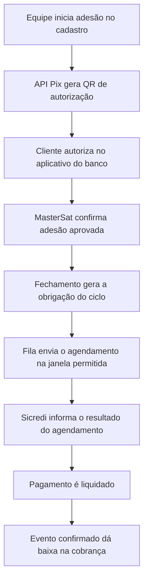

**Análise da API Pix Sicredi para o MasterSat - 05/11/2026**

Esta análise compara o código local do MasterSat com o PDF fornecido pelo usuário: `drupal-2g2qmzii-guia-tecnico-integracao-apipix-sicredi-v2-1 (1).pdf`, versão 2.1 de **07/07/2026**, com **54 páginas**. As páginas citadas abaixo correspondem tanto à numeração impressa quanto à posição no PDF. O arquivo tem SHA-256 `56b361cd12186f1a26b3dcb7c0663f41c4d8ee841fe4118c90a7762912f442e8`.

Foram lidos o texto das 54 páginas e os fluxos, tabelas e telas relevantes por renderização. O documento enviado é diferente da revisão de 15/05/2026, com 53 páginas, consultada anteriormente. A orientação de homologação desta revisão de julho deve prevalecer nesta análise.

O resultado é uma avaliação técnica e um plano de implementação. Não foram alterados código da aplicação, configurações de produção ou cobranças. As primeiras credenciais foram recusadas no sandbox e em produção (itens 15 e 16). Após o recebimento das credenciais geradas para o certificado validado, a autenticação e as consultas de leitura em produção funcionaram (item 17). Nenhuma cobrança, autorização ou configuração de webhook foi criada ou alterada.

**1. O que já temos e o que precisa ser acrescentado**

A base financeira existente é aproveitável. A conexão Pix descrita neste guia, porém, exige um cliente HTTP e registros próprios, porque a autenticação e o ciclo de cobrança diferem da API de Cobrança usada hoje.

| Componente | Situação encontrada no projeto | Trabalho necessário para API Pix |
|---|---|---|
| Clientes, responsáveis financeiros, veículos e contratos | Implementados | Vincular a adesão ao responsável financeiro correto |
| Fechamento mensal e cobranças consolidadas | Implementados | Criar fila de agendamento Pix após o fechamento, respeitando o ciclo da recorrência |
| Boleto Sicredi tradicional e híbrido | Implementado, individual e em lote | Preservar o canal existente e incluir Pix como canal próprio |
| QR Code no boleto | Implementado com dados do boleto híbrido | Renderizar também o `pixCopiaECola` da API Pix e da adesão recorrente |
| Autenticação Sicredi | OAuth2 `password`, API key e código de acesso | Implementar mTLS e OAuth2 `client_credentials` para API Pix |
| Identificador do boleto | Nosso número, seu número e convênio | Registrar também `idRec`, `txid` e `endToEndId`, conforme o recurso Pix |
| Baixa e conciliação dos boletos | Implementadas por consulta, com rotina horária | Criar recepção de eventos Pix e recuperação por consultas da API Pix |
| Preferência Pix Automático por cliente | Não encontrada | Criar opção, estados de adesão e ações de autorização/cancelamento |
| Adesões e agendamentos recorrentes Pix | Não encontrados | Criar persistência, serviços, endpoints e acompanhamento na interface |
| Webhooks específicos da API Pix | Não encontrados | Implementar e cadastrar notificações de pagamentos, recorrências e cobranças recorrentes |

Evidências locais: `backend/app/services/sicredi_client.py`, `sicredi_boletos.py`, `sicredi_lotes.py`, `titulo_bancario.py`, `financial.py`, `billing_closure/__init__.py`, `backend/app/models/client.py`, `sicredi_boleto.py`, `backend/app/core/config.py` e componentes de Clientes/Financeiro. A inspeção considera o código no commit `4cb3b55`; não foi feita nova auditoria da VPS nesta avaliação.

O portal oficial também distingue as duas integrações: [autenticação por produto](https://developers.sicredi.com.br/public/docs/general-information). As credenciais fornecidas anteriormente, identificadas como API key, username e Código de Acesso, correspondem ao fluxo da API de Cobrança. Posteriormente, o usuário informou Client ID e Client Secret e forneceu chave/CSR, certificado assinado, cadeia e chave Pix. As conferências locais e o teste de autenticação no sandbox constam dos itens 14 e 15.

**2. O pacote que precisamos obter ou conferir junto ao Sicredi**

| Item | Origem e referência no guia | Situação para a MasterSat |
|---|---|---|
| Adesão à API Pix e modalidades de recebimento | Cooperativa, análise e termo; p. 12 | Confirmar o atendimento da adesão, incluindo Pix Automático Recebedor |
| ID da adesão | E-mail de boas-vindas; pp. 14 e 36 | Ainda não identificado no material fornecido |
| Acesso do responsável técnico à conta no Portal | Chamado com CNPJ e ID de adesão; pp. 13-14 e 35-37 | Conferir vínculo autorizado para a conta da MasterSat |
| Chave Pix vinculada à conta Sicredi | Pré-requisito, p. 13 | Recebida: CNPJ `14228344000167`; vínculo e habilitação no sandbox ainda não confirmados por consulta bancária |
| Certificado assinado pelo Sicredi | Arquivo `.CER`, pp. 14 e 17 | `14228344000167.cer` recebido e conferido: PEM, autenticação cliente, válido e correspondente à chave/CSR |
| Chave privada correspondente | Arquivo `.KEY`, pp. 14, 17 e 38-39 | `MasterSatCSR-sem-senha.key` conferida: RSA 2048, corresponde ao CSR e ao certificado assinado |
| Cadeia completa de certificados | Download no Portal, pp. 14 e 17 | `CadeiaCompletaSicredi.cer` recebida: duas CAs, assinaturas e encadeamento local verificados |
| Client ID e Client Secret | Gerados sobre o certificado validado, p. 15 | Novo par gerado para o certificado validado: autenticação e consultas de leitura em produção confirmadas no item 17, sem reproduzir valores neste relatório |
| Acesso, credenciais e chave Pix de HML | Procedimento específico, pp. 15-16 | Teste com o conjunto informado retornou HTTP 401; conferir habilitação e vínculo no HML, separadamente de produção |
| Collection API Pix Sicredi | Portal > APIs de Recebimentos > Documentação; pp. 42 e 44 | Recebida em `drupal-64wdzexv-collectionapipixsicredi.json`; análise de suas 62 requisições no item 13 |
| Certificado `webhook-sicredi.CER` | Opcional para autenticação do webhook, pp. 14 e 21 | Disponível para o projeto de validação da origem dos eventos |

Os dados bancários já informados identificam a conta recebedora: CNPJ da MasterSat, cooperativa/agência 2602 e conta 20886-5. O guia recomenda informar `recebedor.agencia` nas cobranças recorrentes (p. 10). Precisamos conferir na collection o formato da conta e de seu dígito; não transportar automaticamente o formato agência/posto/beneficiário dos boletos para todos os campos Pix.

Os certificados e as credenciais desta integração são os do recebedor/integrador. Para aderir ao Pix Automático, cada cliente pagador autoriza a recorrência em seu banco; não precisa fornecer as credenciais bancárias da MasterSat.

**3. Certificados e autenticação**

O fluxo descrito nas pp. 17-20 é:

1. Abrir conexão TLS com certificado cliente, chave privada e cadeia de confiança.
2. Autenticar em `POST /oauth/token`, usando Basic com `client_id:client_secret`, formulário `grant_type=client_credentials` e os escopos necessários.
3. Usar o Bearer recebido nas chamadas dos recursos Pix, mantendo a conexão mTLS.
4. Reutilizar o token enquanto válido e renová-lo conforme `expires_in`. O guia exemplifica 300 segundos; a aplicação deve respeitar a resposta, sem assumir que todo ambiente terá sempre esse prazo.

| Ambiente | Host informado no guia |
|---|---|
| Homologação | `https://api-pix-h.sicredi.com.br` - p. 15 |
| Produção | `https://api-pix.sicredi.com.br` - pp. 19-20 |

O host de homologação foi explicitamente atualizado nesta revisão. Os caminhos de recurso e suas versões devem ser validados na collection: o próprio guia combina `/v1/rec`, `/v2/cobv` e `/v3/cob`. Não aplicar um prefixo `/v2` indiscriminadamente.

A implementação proposta precisa ter configuração independente da API de boletos: ambiente, host, Client ID, Client Secret, certificado, chave, CA, chave Pix e conta recebedora. Arquivos devem ser disponibilizados ao backend e ao worker sem incorporar chaves à imagem ou ao repositório.

As pp. 42-43 e 51-54 explicam diferenças entre PEM e DER e a correspondência entre certificado e chave. Alterar a extensão não converte o conteúdo. A conferência deve verificar validade, chave pública correspondente, cadeia e vínculo das credenciais com o certificado. O certificado comum do site HTTPS e o certificado utilizado para NFS-e não devem ser assumidos como substitutos do certificado de integração Sicredi.

O caminho recomendado pelo guia é gerar e acompanhar o CSR no Portal. O Anexo III, pp. 49-50, apresenta geração manual como alternativa para indisponibilidade do Portal, não como primeira opção. No formulário, conferir a identificação do integrador, destacada na p. 37.

**4. Escopos que precisam estar liberados**

O guia, p. 29, deixa claro que as permissões dependem das modalidades solicitadas na adesão. Um token emitido com sucesso não demonstra acesso a todas as funcionalidades.

| Necessidade | Permissões a conferir |
|---|---|
| Cobrança imediata | `cob.read`, `cob.write` |
| Cobrança com vencimento | `cobv.read`, `cobv.write`; lotes, se contratados: `lotecobv.read`, `lotecobv.write` |
| Cobrança recorrente | `cobr.read`, `cobr.write` |
| Gerenciar adesões e locations recorrentes | `rec.read/write`, `payloadlocationrec.read/write` |
| Receber eventos da recorrência e da cobrança recorrente | `webhookrec.read/write`, `webhookcobr.read/write` |
| Consultar Pix e configurar notificações dos Pix recebidos | `pix.read`, `webhook.read/write`, conforme o fluxo contratado |

Os grupos adicionais de recorrência e notificações foram conferidos na [especificação pública do Banco Central, versão 2.9.0](https://raw.githubusercontent.com/bacen/pix-api/2.9.0/openapi.yaml). Essa referência não estabelece qual versão o Sicredi habilitou para esta conta; confirmar a cobertura na collection e na homologação. Permissões para devolução e para a Jornada 1 só devem ser acrescentadas se essas funções entrarem no escopo.

**5. Modalidades e escolha da jornada para o nosso sistema**

| Modalidade | Uso no MasterSat |
|---|---|
| Pix imediato, `cob` | Cobrança pontual com pagamento iniciado pelo pagador |
| Pix com vencimento, `cobv` | Fatura Pix com data de vencimento, paga pelo cliente |
| Pix Automático, `rec` + `cobr` | Adesão prévia e instruções mensais para agendamento |

Conforme pp. 6-9, há quatro jornadas de adesão:

| Jornada | Experiência do cliente | Aplicação sugerida |
|---|---|---|
| 1 | Confirma notificação no app do banco, a partir dos dados bancários informados | Atendimento que já disponha desses dados e dispense QR de adesão |
| 2 | Lê QR ou usa Copia e Cola apenas para autorizar a recorrência | Melhor ponto de partida para clientes já cadastrados e fechamento mensal |
| 3 | Paga uma cobrança imediata e autoriza as próximas no mesmo fluxo | Nova contratação com primeira cobrança no ato |
| 4 | Paga/agende uma cobrança e recebe oferta opcional de adesão | Oferta vinculada a uma fatura Pix com vencimento |

A recomendação de começar pela **Jornada 2** é uma decisão de arquitetura para o MasterSat, não uma exigência do Sicredi. O cliente passa a ter uma adesão mensal vinculada ao seu cadastro/responsabilidade financeira, e o fechamento continua determinando o valor da obrigação.

O guia descreve, para essa jornada, criar location, criar recorrência e consultar a recorrência para obter `pixCopiaECola` (p. 7). A aplicação renderiza esse conteúdo como QR Code; o banco não precisa devolver uma imagem pronta (pp. 26-27).



Habilitar uma opção pela equipe não equivale à autorização do pagador, e autorização não equivale a pagamento. Na Jornada 4, inclusive, pagar a fatura não obriga o cliente a aceitar a adesão (p. 8).

**6. O que precisa existir no cadastro e no banco de dados**

Proposta para desenvolvimento, ainda não implementada:

| Registro | Informações principais |
|---|---|
| Preferência do cliente | Oferta de Pix Automático, responsável financeiro, acesso às ações e estado exibido |
| Adesão/recorrência | `idRec`, referência do contrato, devedor, periodicidade, primeiro vencimento, política de valores/retentativas, location, QR de adesão, ambiente e histórico |
| Cobrança Pix | ID da cobrança interna, `txid`, adesão, valor, vencimento, ciclo e estado de envio/agendamento |
| Recebimento | `endToEndId`, `txid`, valor, instante da liquidação e vínculo com a cobrança |
| Evento recebido | Identificação, categoria, recebimento, processamento e resultado, para evitar reaplicar notificações |
| Fila | Próxima tentativa, prazo de envio, falha ou resultado desconhecido e retomada após reinício |

Os estados de adesão devem distinguir preparação/erro local dos estados informados pelo banco. A interface precisa mostrar, por exemplo, aguardando autorização, aprovada, rejeitada, expirada e cancelada. As cobranças têm seu próprio andamento, distinto da adesão.

A operação deve ser vinculada ao **responsável financeiro** da cobrança, e não automaticamente ao proprietário do veículo. Esse vínculo já existe em `payer_client_id`. Caso um cliente tenha vários contratos ou veículos, o agrupamento deve respeitar o objeto autorizado e a periodicidade. Também é necessário definir se o objeto da adesão cobrirá apenas mensalidades ou incluirá taxas e serviços adicionais.

Para valores que podem variar após instalações, retiradas ou serviços adicionais, recomendo avaliar autorização de valor variável, sujeita ao limite aceito pelo pagador. Não fixar a adesão em uma mensalidade que pode mudar sem prever como obter nova autorização quando necessário.

**7. Adaptações do fechamento e do controle de duplicidade**

As pp. 10-11 exigem envio das instruções entre **2 e 10 dias corridos** antes da liquidação e tratam cancelamento e retentativas. Na prática, precisamos separar fechamento interno de envio ao banco.

Exemplo: para vencimento em **20/11/2026**, a janela normal é **10/11 a 18/11**. Um fechamento realizado em 05/11 pode criar a obrigação local, mas a fila deve esperar a abertura da janela. Gerar tudo diretamente no banco no instante do fechamento não atende a todos os vencimentos.

A fila deve tratar autorização ainda pendente, cancelamento, mudança do responsável e fechamento tardio. Uma cobrança fora da janela fica para análise do financeiro; não deve ser transformada silenciosamente em débito imediato.

O [Guia de Implementação do Banco Central](https://www.bcb.gov.br/content/estabilidadefinanceira/pix/automatico/guia_pix_automatico.pdf), pp. 34-37, também exige compatibilidade do valor e um pagamento previsto por ciclo da recorrência. Portanto, o ciclo deve ser derivado da data inicial e periodicidade da adesão, sem presumir que coincide sempre com o mês civil ou com o mês do serviço. O fechamento atual consolida por responsável quando configurado; clientes com cobrança individual demandam uma regra específica para aderir a uma recorrência consolidada ou a vínculos distintos.

A proteção já existente em `titulo_bancario.py` deve abranger o novo canal. Uma mesma obrigação não pode continuar com boleto pagável e receber um agendamento automático independente sem tratamento da transição. Reservar identificadores antes do envio e consultar um resultado incerto antes de reenviar evita duplicações por timeout ou reinício. Títulos antigos não devem ser convertidos automaticamente.

Agendado não é pago. A baixa financeira só deve ocorrer após liquidação confirmada e correspondência de identificação e valor. Divergências precisam gerar uma pendência para a equipe, aproveitando a lógica de conferência existente.

**8. Webhooks, conciliação e infraestrutura**

As pp. 20-21 descrevem três famílias de notificações: Pix recebidos, recorrências e cobranças recorrentes. No webhook de cobranças `cob/cobv`, a chave cadastrada precisa ser a mesma usada nas cobranças.

Precisamos criar rotas HTTPS acessíveis na porta 443, configurar o proxy/servidor para a cadeia Sicredi e estabelecer a validação de origem. O guia exige certificado do site emitido por CA pública e oferece certificado do webhook para validação adicional. O certificado do site e o certificado cliente usado pelo backend têm funções diferentes.

A proposta é persistir o evento, confirmar seu recebimento sem esperar processamento demorado e processá-lo com idempotência. A conciliação de recuperação consulta janelas de tempo curtas, com paginação e retomada, para eventos perdidos ou períodos de indisponibilidade (pp. 22-26).

A p. 26 afirma que a notificação de liquidação já representa a confirmação da transação. Por isso, uma notificação de origem autenticada pode fundamentar a baixa; não é necessário consultar o banco novamente apenas para reconfirmar cada evento. Consultas continuam úteis para recuperar faltantes e esclarecer inconsistências.

O domínio público e o proxy já fazem parte da arquitetura do MasterSat, mas a configuração específica de recepção/validação dos eventos Pix precisa ser implementada e testada. A conciliação horária dos boletos não é substituída automaticamente por esses novos endpoints.

A p. 25 pede atenção a UTC. A implementação deve fazer conversões com fuso explícito. Por exemplo, o dia 05/11 em Brasília corresponde ao intervalo UTC de `2026-11-05T03:00:00Z` até `2026-11-06T03:00:00Z`, com tratamento da fronteira. Simplesmente subtrair três horas de uma data local, sem converter o fuso, causa omissões ou duplicações. O projeto já tem utilitário de horário de Brasília que pode apoiar essa adaptação.

**9. Cancelamentos, falhas e devoluções**

| Evento | Tratamento necessário |
|---|---|
| Pagador cancela a adesão | Atualizar o cadastro e suspender novas instruções daquela recorrência |
| Equipe encerra a recorrência | Pedir cancelamento ao banco e acompanhar a confirmação; desmarcar um campo local não basta |
| Cancelamento de um agendamento | Respeitar o limite do guia de até 22h da véspera e confirmar o resultado (p. 10) |
| Sem saldo ou limite no dia | Acompanhar a tentativa do banco, inclusive a janela intradia prevista (p. 11) |
| Nova tentativa após vencimento | Só comandar se prevista na política da recorrência; seguir as regras e prazos específicos |
| Timeout/erro após envio | Conservar o resultado como incerto e consultar a operação antes de nova tentativa |
| Pagamento com valor diferente ou sem vínculo seguro | Registrar pendência, sem quitar outra obrigação por aproximação de nome/valor |
| Devolução | Registrar operação, valor, identificador e resultado; refletir o efeito financeiro |

Segundo o guia Bacen, pp. 29-32 e 41, a revogação afeta a permissão de envio e os agendamentos; os efeitos em pagamentos próximos dependem do momento. As retentativas pós-vencimento têm limite de datas e prazo, preservando o valor original. Esses fluxos precisam de testes próprios e não podem reaproveitar um simples reenvio de emissão de boleto.

Devoluções estão previstas nas pp. 24-25 do guia Sicredi. Se entrarem na primeira entrega, exigem autorização de acesso, ação explícita e controle de duplicidade; não devem ser disparadas automaticamente a partir de uma inconsistência de conciliação.

**10. Homologação e critérios de aceite**

Esta revisão muda uma orientação anterior: o acesso HML é solicitado prioritariamente por chamado no Portal, selecionando Suporte Técnico API Pix. A tela da p. 15 mostra a opção **Cadastro Ambiente Homologação API PIX**; a da p. 16 mostra **Validação de QR CODE Homologação API PIX**.

As credenciais HML, segundo a p. 16, são geradas pelo associado no Internet Banking: Outros Serviços > Acesso à API Pix > Gerar Credenciais, selecionando homologação e o certificado correspondente. No Portal, a geração sobre o certificado validado descrita na p. 15 é para produção. Não intercambiar os conjuntos.

Para liquidar QR Codes de HML, a p. 16 manda abrir chamado para processamento e devolutiva pelo Sicredi. Gerar uma imagem ou obter token, isoladamente, não demonstra criação, aprovação de adesão ou liquidação. A confirmação de testes de autorização e agendamento específicos de Pix Automático deve ser combinada com o suporte, pois a seção HML não detalha integralmente esse roteiro.

Proponho os seguintes critérios para liberar a funcionalidade:

1. Certificado e chave conferidos, token HML emitido e permissões comprovadas por consultas dos recursos necessários.
2. Recorrência criada, identificada por `idRec`, recuperada por consulta e QR de adesão renderizado com o conteúdo oficial.
3. Autorização e recusa demonstradas; marcar a opção no cadastro não coloca a adesão como aprovada.
4. Cobrança de teste agendada na janela, com `txid` persistido e vínculo com a obrigação interna.
5. Liquidação processada no HML pelo Sicredi e recebimento conciliado com valor, identificador e data corretos.
6. Evento repetido, evento fora de ordem, consulta repetida e reinício de worker não duplicam pagamento ou agendamento.
7. Cancelamento, expiração, insuficiência de saldo, prazo perdido e valor acima do autorizado deixam estados e mensagens adequados.
8. Boleto já registrado impede cobrança simultânea do mesmo débito por Pix Automático.
9. Janela UTC/Brasília, virada de mês e vencimento no último dia do mês preservam período e ciclo corretos.
10. Nenhuma emissão ou conversão de cobranças existentes acontece pela simples ativação das configurações.

O teste de aceitação deve registrar as respostas reais do HML e as devolutivas do suporte. Respostas simuladas em testes unitários continuam úteis, mas não substituem essa evidência bancária.

**11. Pontos do documento que exigem atenção na implementação**

| Ponto | Como lidar |
|---|---|
| Revisões diferentes com o mesmo número 2.1 | Identificar sempre data e quantidade de páginas; este estudo usa 07/07/2026, 54 páginas |
| URLs nas pp. 22 e 24 usam `api-pix-sicredi.com.br`, divergente do host das pp. 19-20 | Não copiar essas URLs cegamente; validar os hosts e caminhos na collection oficial |
| `SolicRec` na p. 6 e criação com `PUT /v1/rec` sem identificador na p. 8 | Conferir método, capitalização e parâmetros na especificação e collection |
| Esquemas JSON completos não constam do guia | Usar a especificação Bacen e a collection Sicredi, como o próprio documento determina |
| Exemplos públicos de referência usam `pix.example.com` | Trata-se de exemplo de servidor; não configurar esse domínio na integração |
| P. 25 descreve ajuste de três horas de maneira que pode induzir conversão invertida | Implementar e testar conversão de fuso, não aritmética isolada sobre datas |
| Referências internas a anexos XXX/VI e trecho divergente no CSR manual | Preferir o fluxo do Portal e esclarecer formato com suporte antes de gerar manualmente |
| Customização de dados do pagador nas pp. 23-24 | É opcional, solicitada à cooperativa; não condicionar a baixa a campos extras que podem não existir |
| Custos, limites operacionais e permissões da conta | Não são determinados pelos exemplos; confirmar com a cooperativa |

As referências oficiais [Criar recorrência](https://developers.sicredi.com.br/public/reference/post_rec) e [Criar cobrança recorrente por txid](https://developers.sicredi.com.br/public/reference/put_cobr-txid) complementam o guia. Os exemplos de referência não substituem a validação da URL de implantação do Sicredi.

**12. Ordem recomendada para o trabalho**

Primeiro, conferir adesão, ID, chave Pix, certificados, credenciais de HML e collection. Depois, implementar a conexão mTLS, consultas e validação da conta. Na sequência, criar a adesão por cliente pela Jornada 2, com estados visíveis, autorização e cancelamento. Então integrar o fechamento à fila de agendamentos, à proteção contra duplicidade e à conciliação de eventos. A liberação operacional vem após os testes do HML.

Pix imediato, Pix com vencimento, Jornadas 1/3/4 e devoluções podem ser entregues conforme a necessidade do negócio; implementar todas as modalidades não é pré-requisito para iniciar pela Jornada 2.

Texto que pode ser usado pela MasterSat ao solicitar a conferência do acesso, sem envio realizado nesta avaliação:

> Precisamos integrar a API Pix Sicredi com Pix Automático Recebedor para a conta da MasterSat, usando inicialmente a Jornada 2. Solicitamos confirmar adesão e ID, liberação de homologação, chave Pix de teste, certificado assinado e cadeia, geração das credenciais e permissões de recorrências, locations, cobranças recorrentes, Pix recebidos e respectivos webhooks. Precisamos também da collection atual e do roteiro para validar autorização, agendamento, liquidação e cancelamento em HML.

As primeiras credenciais receberam HTTP 401. Com o novo par gerado sobre o certificado validado, a conexão de produção e as consultas de leitura passaram, conforme item 17. O ambiente de homologação continua dependendo do cadastro e das credenciais específicos descritos nas pp. 15-16; o novo par de produção não foi testado no HML. O código existente oferece a base financeira, mas os módulos de adesão, conexão Pix, eventos e agendamento ainda precisam ser desenvolvidos.

**13. Atualização: análise da collection recebida**

Foi lido o arquivo `drupal-64wdzexv-collectionapipixsicredi.json`, de 122.399 bytes, nome interno `API Pix Sicredi`, formato declarado Postman Collection v2.1. A análise foi estática: nenhum script ou pedido contido no arquivo foi executado.

São **62 requisições**, distribuídas entre autenticação (1), cobranças com vencimento (7), cobranças imediatas (9), gestão de Pix (4), payload de recorrência (4), Pix Automático (27) e webhooks (10). Não há respostas bancárias salvas nos exemplos. As 26 variáveis declaradas estão vazias, inclusive host, credenciais, token, chave Pix, agência e conta; não há certificado cliente incorporado.

| Etapa da Jornada 2 | Método e caminho confirmados na collection |
|---|---|
| Gerar location | `POST /api/v1/locrec` |
| Criar a recorrência | `POST /api/v1/rec`, vinculando o ID da location |
| Consultar recorrência | `GET /api/v1/rec/{idRec}` |
| Criar cobrança de um ciclo | `PUT /api/v1/cobr/{txid}` ou `POST /api/v1/cobr` |
| Consultar a cobrança | `GET /api/v1/cobr/{txid}` |
| Configurar eventos da adesão | `PUT /api/v1/webhookrec` |
| Configurar eventos da cobrança recorrente | `PUT /api/v1/webhookcobr` |
| Configurar eventos Pix de cob/cobv | `PUT /api/v2/webhook/{chavePix}`, quando essa modalidade for utilizada |

O arquivo resolve parte das dúvidas de prefixo e capitalização: usa `/api/v1/solicrec` em minúsculas e criação de recorrência por `POST /api/v1/rec`. Apresenta `cobv` em `/api/v2` e cobranças imediatas em `/api/v3`; porém o exemplo da Jornada 3 ainda cria a cobrança imediata em `/api/v2/cob`. Esse último ponto continua sujeito à validação em HML conforme a versão do recurso disponibilizado pelo Sicredi.

Há adaptações concretas antes de usar a collection no Postman ou como base do código:

1. **Scripts de ferramentas diferentes.** Apesar do formato Postman, o script global e diversos scripts de resposta usam `bru.setVar(...)` e `res.getBody()`, próprios do Bruno. Outros scripts usam `pm`. Foram encontrados 29 eventos de script com `bru` e 8 com `pm`, contando o global; as contagens não implicam exclusividade entre os grupos. No Postman, a etapa global pode falhar por `bru` não existir, e o token/IDs podem deixar de ser salvos. É necessário uniformizar os scripts para a ferramenta escolhida. Referências: [Bruno JavaScript](https://docs.usebruno.com/testing/script/javascript-reference) e [Postman Response](https://learning.postman.com/docs/tests-and-scripts/write-scripts/postman-sandbox-reference/pm-response/).
2. **Pedido de token diferente do guia.** `Auth / Gerar access token` está com `Content-Type: application/json`, sem corpo, e `grant_type=client_credentials` na query. O guia, p. 19, descreve formulário `application/x-www-form-urlencoded`, com `grant_type` e `scope` no corpo, e Basic com as variáveis `clientId`/`clientSecret`. O `scope` não está declarado nesse pedido. Adaptar ao contrato documentado e conferir os escopos efetivamente liberados; não presumir que um token sem escopo explícito habilita todos os recursos.
3. **Exemplo da Jornada 2 não representa o MasterSat.** A criação usa data inicial `2024-10-10`, periodicidade `ANUAL`, valor mínimo `5000.00`, referência de contrato e pagador de demonstração. Também escolhe `PERMITE_3R_7D`. Preparar dados reais de HML, periodicidade mensal, data futura compatível e política de valores/retentativas deliberadamente escolhida. O mínimo de R$ 5.000 é somente exemplo e não é um valor exigido pelo Sicredi.
4. **Variáveis numéricas e ordem do fluxo.** O body de criação da Jornada 2 contém `"loc": {{idLocRec_jornada2}}` sem aspas. Ele é um template, não JSON pronto para envio antes da substituição. Criar a location antes da recorrência, recuperar os IDs das respostas com sucesso e consultar o QR de adesão. A ordem visual da pasta não deve ser usada como ordem de execução automática.
5. **Datas de conciliação.** O script global monta início/fim do dia corrente em UTC. Para representar um dia de Brasília, precisamos fazer a conversão de fuso descrita no item 8, em vez de usar diretamente a meia-noite UTC.
6. **Host de devolução.** A requisição de solicitar devolução usa `baseUrlToken`, enquanto a maioria usa `baseUrl`. Como ambos estão vazios, conferir o destino e impedir mistura de ambientes. Não é uma razão para executar devoluções nos testes iniciais.

A presença desses endpoints na collection confirma a cobertura dos exemplos para nosso desenho. Ela não demonstra que a conta ou o Client ID informado tenham todos os escopos liberados. Também não identifica quais caixas da lista genérica de APIs do Portal concedem cada permissão.

O pacote já recebido passa a incluir manual, collection, Client ID/Secret informados, chave privada sem senha e CSR com assinatura válida. A chave sem senha corresponde ao CSR; o arquivo de chave protegida por senha não foi descriptografado. Continuam pendentes de conferência o certificado assinado Sicredi, sua cadeia, chave Pix, ambiente das credenciais e liberação dos recursos. Não houve alteração na collection original nem execução de chamadas bancárias nesta atualização.

**14. Atualização: certificado assinado e cadeia recebidos e conferidos**

Em 05/11/2026 foram recebidos os caminhos locais de `14228344000167.cer` e `CadeiaCompletaSicredi.cer`, na pasta Downloads. A verificação foi local, usando a biblioteca cryptography, sem expor chave privada ou realizar conexão ao banco.

| Verificação | Resultado |
|---|---|
| Certificado da aplicação | Um certificado em formato PEM, CN `api-pix-14228344000167` |
| Validade | De 05/11/2026 16:39:18 UTC até 05/11/2028 04:39:48 UTC; válido no momento da conferência |
| Correspondência com `MasterSatCSR-sem-senha.key` | Confirmada pela igualdade das chaves públicas |
| Correspondência com `MasterSatCSR.csr` | Confirmada pela igualdade das chaves públicas |
| Uso estendido para autenticação cliente | Presente (`clientAuth`) |
| Cadeia fornecida | Duas autoridades certificadoras em formato PEM |
| Emissor da aplicação | Autoridade Certificadora Subordinada Sicredi 2040; assinatura conferida e CA válida |
| Raiz da cadeia | Autoridade Certificadora Privada do Sicredi 2042; encadeamento e assinatura própria conferidos; CA válida |

Assim, o pacote de certificado, chave e cadeia está consistente para preparar o mTLS. Essa conferência não inclui consulta de revogação, aceitação pelo servidor, vínculo do Client ID com o certificado, ambiente das credenciais ou permissões bancárias. A atualização seguinte registra a chave Pix recebida e o resultado da tentativa de autenticação. As credenciais e arquivos privados não foram inseridos no repositório.

**15. Atualização: chave Pix recebida e autenticação tentada no sandbox**

Foi recebida a chave Pix CNPJ `14228344000167`. Em 05/11/2026, às 17:39 UTC, foi tentado `POST https://api-pix-h.sicredi.com.br/oauth/token`, conforme o host de HML da p. 15 e o contrato da p. 19: Basic com o Client ID/Secret informados, formulário `grant_type=client_credentials` e escopos de leitura, apresentando o certificado assinado e a chave privada correspondente por mTLS. A verificação TLS do servidor permaneceu habilitada. A chave Pix não participa desse pedido de token.

Resultado real do banco:

```json
{
  "http_status": 401,
  "title": "Acesso Negado",
  "detail": "Authorization ou certificado inválido."
}
```

O resultado não permite distinguir sozinho credenciais incorretas, credenciais de outro ambiente ou ausência de vínculo/liberação do certificado no HML. O fato de a chave privada corresponder ao certificado foi comprovado localmente; isso não comprova que o conjunto esteja cadastrado no sandbox. O guia, pp. 15-16, diferencia expressamente a geração/liberação de HML da de produção.

Nenhum token foi obtido. Portanto não foram executadas as consultas planejadas de recorrências, locations, cobranças recorrentes, Pix recebidos ou webhooks, e os escopos do Pix Automático ainda não estão comprovados. Não houve tentativa em produção, emissão, adesão de cliente, agendamento ou alteração de webhook. O resultado sem segredos está em `tmp/sicredi-pix-automatico/resultado-acesso-hml-20261105.json`; o diagnóstico temporário lê credenciais de forma oculta e não as grava.

Para avançar, o Sicredi precisa esclarecer o HTTP 401 no endpoint de homologação e confirmar o cadastro/vínculo do Client ID com esse certificado no HML, além das modalidades habilitadas. A chave Pix e os arquivos solicitados já foram fornecidos pelo usuário; não é necessário solicitá-los novamente.

**16. Atualização: teste de autenticação em produção autorizado pelo usuário**

Também foi tentado `POST https://api-pix.sicredi.com.br/oauth/token`, com as mesmas credenciais e certificado, Basic, formulário `client_credentials`, escopos somente de leitura e validação TLS habilitada. O objetivo autorizado era autenticar e, se possível, realizar consultas GET; não emitir nem agendar cobranças.

O Sicredi retornou novamente **HTTP 401**, título **Acesso Negado**, detalhe **Authorization ou certificado inválido.** Não foi obtido token e nenhuma consulta de recursos foi executada. O resultado sanitizado está em `tmp/sicredi-pix-automatico/resultado-acesso-producao-20261105.json`.

A hipótese de que bastaria trocar o host de HML por produção não se confirmou. A resposta não discrimina se o problema é o par Client ID/Secret, seu vínculo com o certificado ou sua liberação no ambiente. O passo indicado é conferir no Sicredi o vínculo das credenciais ao arquivo de tipo `CERTIFICADO_VALIDADO` da API Recebimento > Pix > Certificados e Credenciais, conforme p. 15, e solicitar análise do HTTP 401 se o vínculo estiver correto. Nenhuma configuração da VPS, webhook, adesão, boleto ou cobrança foi alterada.

**17. Atualização: novas credenciais do certificado validadas em produção**

O usuário forneceu outro par Client ID/Client Secret, identificado no portal como credencial de produção do certificado `14228344000167.cer`. Os valores foram usados apenas em memória no diagnóstico local, sem serem gravados em código, arquivo de resultado ou relatório.

Com esse novo par e o mesmo conjunto certificado/chave/cadeia, `POST https://api-pix.sicredi.com.br/oauth/token` retornou **HTTP 200**, token Bearer com `expires_in=300`, concedendo todos os escopos de leitura solicitados: `rec.read`, `payloadlocationrec.read`, `cobr.read`, `pix.read`, `webhookrec.read`, `webhookcobr.read` e `webhook.read`.

| Consulta GET | Resultado observado |
|---|---|
| `/api/v1/rec` | HTTP 200, lista vazia na janela consultada |
| `/api/v1/locrec` | HTTP 200, lista vazia na janela consultada |
| `/api/v1/cobr` | HTTP 200, lista vazia na janela consultada |
| `/api/v2/pix` | HTTP 200; uma entrada na página limitada a um registro, sem expor dados do recebimento |
| `/api/v1/webhookrec` | HTTP 404, `Webhook não encontrado.` |
| `/api/v1/webhookcobr` | HTTP 404, `Webhook não encontrado.` |
| `/api/v2/webhook/{chavePix}` para a chave informada | HTTP 404, `Webhook não encontrado.` |

As listas foram consultadas para as últimas 24 horas e com limite de um registro por página; os resultados não constituem inventário histórico nem contagem total de recebimentos. O 404 dos webhooks indica que as consultas não encontraram essas configurações, e não uma falha de autenticação. A consulta do webhook da chave não comprova, isoladamente, seu cadastro no DICT.

Assim, o acesso de leitura em produção está comprovado. O sucesso com o novo par demonstra que o conjunto anterior de credenciais não serviu para esses testes e que o certificado usado consegue autenticar com o par correto. Não foram solicitados escopos de escrita, criados recursos ou testados autorização, agendamento e liquidação de Pix Automático. Esses fluxos e a implementação da aplicação continuam pendentes; autenticação bem-sucedida não significa funcionalidade completa entregue.

Evidência sem segredos: `tmp/sicredi-pix-automatico/resultado-acesso-producao-20261105-certificado.json`. Os resultados dos testes anteriores foram preservados. Não houve alteração de VPS, clientes, boletos, cobranças, adesões ou webhooks.

**18. Implementação local autorizada após a análise**

Após os testes de leitura, o usuário autorizou a implementação e esclareceu que Pix Automático deve ser uma opção na mesma lista de formas de cobrança de boleto, carnê e cartão de crédito. A implementação local passou a incluir esse cadastro, Jornada 2, fila por ciclo integrada ao fechamento, acompanhamento no Financeiro, conciliação e callbacks que apenas sinalizam consultas autenticadas. A operação de produção continua bloqueada para escrita. Configuração, regras e limites de homologação estão em [pix-automatico.md](pix-automatico.md).

A migração `c1f6a8d3e902` foi validada em banco descartável e aplicada somente no ambiente local. Nenhum cliente foi convertido, nenhuma autorização ou cobrança bancária foi criada e a VPS permaneceu sem alterações.
